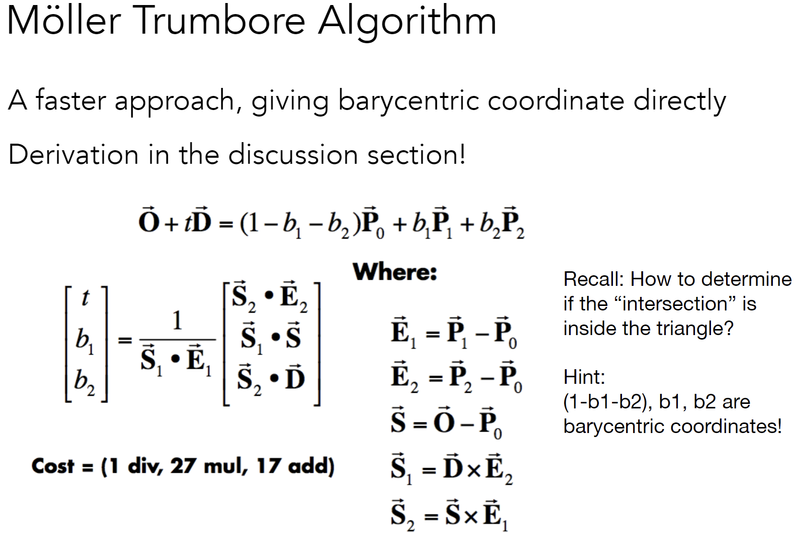
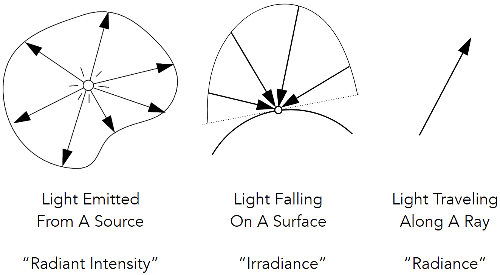
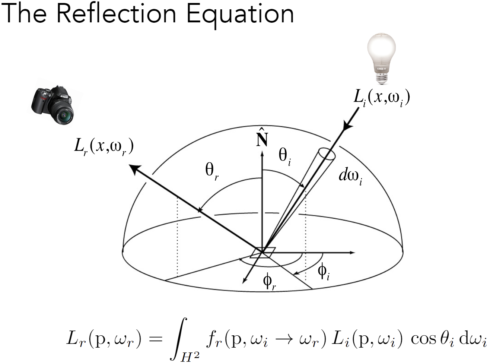

# Ray Tracing

## Whitted-Style Ray Tracing

### 为什么需要光线追踪

因为光栅化无法很好的解决全局效果，比如软阴影，尤其是光线多次弹射的情况
- soft shadows
- glossy reflection
- indirect illumination

光线追踪是精确的，但是很慢。

### 基础的光线追踪算法

**三个假设**
1. 光沿直线传播
2. 光线不会发生碰撞
3. 光路可逆


### 光线投射

1. 以摄像机为原点向每个像素点的中心发射一条光线，光线与场景中的物体相交，则最近的交点
2. 以光线为原点向上面得到的交点发射一条光线，如果在交点之前遇到碰撞，则这点在阴影中，否则返回 Bline Phong model 的值

### Recursive (Whitted-Style) Ray Tracing

在计算出最近的交点后，根据材质会发射 Reflected ray (specular reflection) 和 Refracted rays (specular transmission)

### 光线与几何的求交

#### sphere
ray : $r(t) = \mathbf{o} + t\mathbf{d}$

sphere : $\mathbf{p}:(\mathbf{p} - \mathbf{c})^2 - R^2 = 0$

将光线代入 P 点

$$
(\mathbf{o} + t\mathbf{d} - c)^2 - R^2 = 0
$$

也就是求一个 $at^2 + bt + c = 0$ 形式的一元二次方程, 使用球根公式求解即可，在实际操作中可以有小优化

$$
\begin{align}
 a &= \mathbf{d} \cdot \mathbf{d} \\
 b &= 2(\mathbf{o} - c) \cdot \mathbf{d} \\
 c &= (\mathbf{o} - \mathbf{c}) \cdot (\mathbf{o} - \mathbf{c}) - R^2
\end{align}
$$

对与 sphere 类似的隐式表明，都可以类似的计算

#### triangle

**简单求法**

1. 三角形可以确定一个平面，只需要求光线与这个平面的交即可
2. 判断交点是否在三角形内

平面任意点 $\mathbf{p}:(\mathbf{p} - \mathbf{p}') \cdot \mathbf{N}$

光路上的点代入
$$
(\mathbf{o} + t\mathbf{d} - \mathbf{p}') \cdot \mathbf{N}
$$

解得

$$
t = \dfrac{\mathbf{p}' - \mathbf{o} \cdot \mathbf{N} }{\mathbf{d} \cdot \mathbf{N} }
$$

**Möller Trumbore Algorithm**



用更少的计算量得到结果，并且可以同时获得重心坐标，方便插值得到纹理。
```cpp
class triangle : public hittable {
public:
  /*
    齐次坐标下三角形的信息
    1. 三个点的坐标 V0，V1，V2，1.0 顺时针
    2. 三个点的颜色信息（R，G，B）
    3. 三个点的材质信息 （U，V）
    4. 三个点的法向量信息（Vector3f）
  */
  point3 v0, v1, v2; // vertices A, B ,C , counter-clockwise order
  vec3d e1, e2;      // 2 edges v1-v0, v2-v0; 求光线交有用
  pdd t0, t1, t2;    // texture coords
  vec3d normal;
  material *mat_ptr;
}
inline auto triangle::interpolate(double &u, double &v, vec3d &Barycentr, double weight) const -> void {
  u = (Barycentr[0] * t0.first + Barycentr[1] * t1.first + Barycentr[2] * t2.first);
  v = (Barycentr[0] * t0.second + Barycentr[1] * t1.second + Barycentr[2] * t2.second);
  if (weight != 1.0) {
    u /= weight;
    v /= weight;
  }
}
// Möller Trumbore Algorithm
auto triangle::hit(const ray &r, interval ray_t, hit_record &rec) const -> bool {
  auto s = r.orig - v0;
  auto s1 = cross(r.dir, e2);
  auto s2 = cross(s, e1);
  auto D = dot(s1, e1);
  if (std::abs(D) < esp)
    return false;
  D = 1 / D;
  auto t = dot(s2, e2) * D;
  auto u = dot(s1, s) * D;
  auto v = dot(s2, r.dir) * D;

  if (t < ray_t.min || t > ray_t.max || u < esp || v < esp || 1 - u - v < esp)
    return false;

  rec.t = t;
  rec.p = r.at(t);
  rec.set_face_normal(r, normal);
  auto Barycentr = vec3d(1 - u - v, u, v);
  interpolate(rec.u, rec.v, Barycentr, 1.0);
  rec.mat_ptr = mat_ptr;
  return true;
}
```

### Object Partitions & Bounding Volume Hierarchy(BVH)

#### 如何构建 BVH

1. 首先是每个 object 需要支持 Axis-Aligned Bounding Box (AABB)  (轴对⻬包围盒)，把所有物体的 AABB 作为根节点，计算当前子树的 AABB
2. 可以按照一些方式选出分界线（比如 取一个与轴平行的最长的方向，或者 SAH 算法等），分割为左右儿子两部分，然后递归建树
3. 在需要时停止，比如该子树只包含一个 object。叶子节点存储的可以时 object list，非叶节点存储两个子树。

#### BVH 遍历（光线求交）

1. 如果光线与当前子树的 AABB 没有相交则返回
2. 若相交则递归判断，是否与左子树及右子树相交，返回最近的交点

## radiometry （辐射度量学）

基础概念

Radiant Flux(power): 单位时间光源辐射的能量 $\phi = \dfrac{\mathrm{d}Q}{\mathrm{d}t}$ 单位是 $W = Watt / lm = lumen$

Radiant Intensity: 光源向单位立体角辐射的 Radiant Flux $I(\omega) = \dfrac{\mathrm{d}\phi}{\mathrm{d}\omega}$ 在球面上立体角为 $\dfrac{A}{r^2}$ 单位是 $\frac{lm}{sr} = cd = candela$

Irradiance: 光源向单位面积辐射的 Radiant Flux $E=\dfrac{\mathrm{d}\phi}{\mathrm{d}A} = \dfrac{\phi}{4\pi r^2}$

Radiance:光源向单位立体角和单位面积所辐射的 Radiant Flux $L=\dfrac{\mathrm{d}^2\phi}{\mathrm{d}\omega \mathrm{d}A \cos \theta}$ 需要 $\cos \theta$



### Bidirectional Reflectance Distribution Function(BRDF)

#### Reflection

反射过程可以认为是从一个 $\omega_i$ 方向射向 $\mathbf{d}A$ 被吸收(irradiance)

$$
\mathbf{d}E(\omega_i) = L(\omega_i)\cos \theta_i \mathbf{d} \omega_i
$$

转化为能量，再朝某个方向发射能量(radiance) 的过程。

$$
\mathbf{d}L_r(\omega_r)
$$

BRDF 便是定义，反射的能量是如何分布的。也就是入射方向 $\omega_i$ 到 出射方向 $\omega_r$ 的一个函数。

$$
f_r(\omega_i \to \omega_r) = \dfrac{\mathbf{d}L_r(\omega_r)}{\mathbf{d}E_i(\omega_i)} = \dfrac{\mathbf{d}L_r(\omega_r)}{L(\omega_i)\cos \theta_i \mathbf{d} \omega_i}\left [ \dfrac{1}{sr} \right ] 
$$

BRDF 定义了不同的材质



反射方程简单的讲就是，各个方向的入射光照到观察点后，向摄像机方向的 radiance。

### The Rendering Equation

渲染方程由两部分组成
1. 自己朝出射方向发射的光
2. 自己朝出射方向的反射的光

$$
L_{out}(p, \omega_{out}) = L_{emit}(p, \omega_{out}) + \int_{\Omega^+} f_{BRDF}(p, \omega_{in}, \omega_{out}) L_{in}(p, \omega_{in})(n \cdot \omega_{in}) \mathbf{d}\omega_{in}
$$

求解渲染方程, $I$ 是单位矩阵，$E$ 是发射的能量

$$
\begin{align}
\mathbf{L} &= E + K\mathbf{L} \\
I\mathbf{L} - K\mathbf{L} &= E \\
(I - K)\mathbf{L} &= E \\
L &= (I - K)^{-1} E \\
\\
\mathbf{L} &= (I + K + K^2 + K^3 + \dots) E \\
\mathbf{L} &= E + KE + K^2E + K^3E + \dots
\end{align}
$$

所以我所接受到的能量 = 直接发射的 + 一次反射的 + 二次反射 + ...

这个结果也就是全局光照，直接与间接光照的集合。


